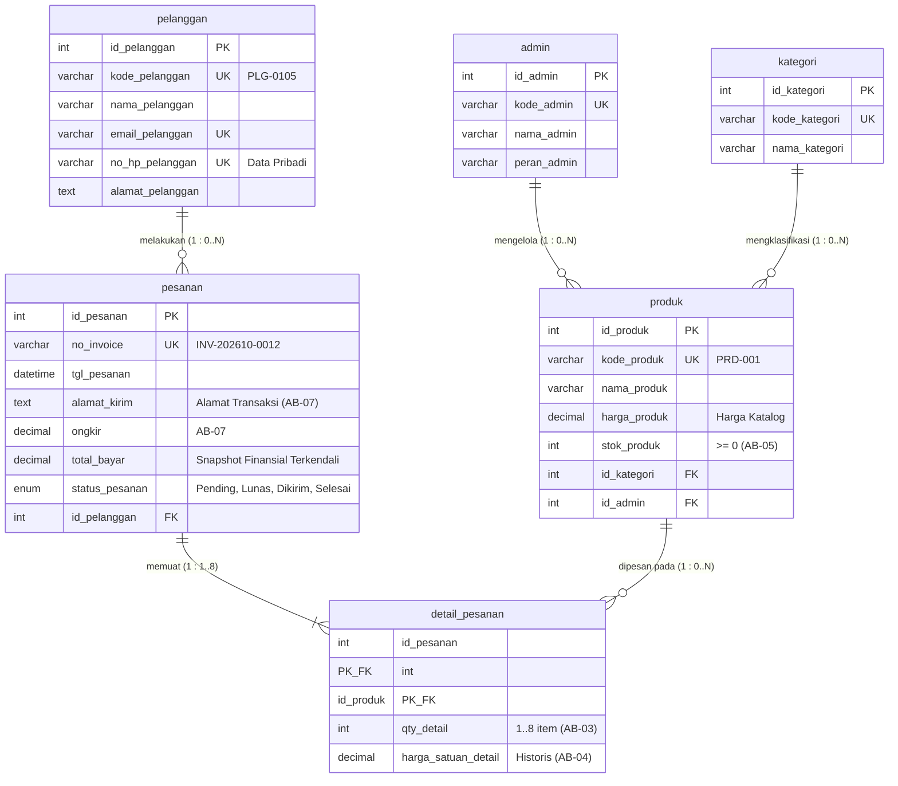

# Tugas Mandiri: Milestone Proyek 4 - Normalisasi Basis Data
**Nama:** Syifa  
**NIM:** 25430105  
**Kelas:** Basis Data Praktikum (Semester 3)  
**Tanggal:** 20 Oktober 2026  
**Dosen/Asisten:** Dedi Irawan, S.Kom., M.T.I.  
**Proyek:** Toko Daring Cendekia SA (Sistem E-Commerce)  
**Dokumen Acuan:** `p02_kebutuhan_data_25430105.md`  

---

## 1. Dokumen Sumber Proyek (Titik Awal UNF)

Titik awal proses perancangan dan normalisasi data diambil langsung dari dokumen transaksi nyata pada dokumen kebutuhan data Pertemuan 2, yaitu **Bukti Pesanan & Invoice Penjualan Online** Toko Daring Cendekia SA.

### 1.1 Dokumen Sumber: Invoice Penjualan Online
```text
--------------------------------------------------------------------------------
                         TOKO DARING CENDEKIA SA
                         Invoice Penjualan Online
--------------------------------------------------------------------------------
No. Pesanan   : INV-202610-0012
Tanggal Order : 06-10-2026 14:00
Pelanggan     : Syifa (ID: PLG-0105 / HP: 08123456789)
Alamat Kirim  : Jl. Metro No. 105, Lampung
--------------------------------------------------------------------------------
Kode Produk | Nama Produk           | Qty | Harga Satuan | Subtotal
--------------------------------------------------------------------------------
PRD-001     | Kemeja Casual Size M  | 2   | Rp150.000    | Rp300.000
PRD-005     | Sepatu Sneaker 42     | 1   | Rp250.000    | Rp250.000
--------------------------------------------------------------------------------
Ongkos Kirim : Rp20.000
Total Bayar  : Rp570.000
Status       : Dikirim
--------------------------------------------------------------------------------
```

---

### 1.2 Bentuk Tidak Ternormalisasi (UNF - Unnormalized Form)
Bentuk tidak ternormalisasi (UNF) memuat seluruh atribut data yang tertera pada dokumen invoice apa adanya, termasuk atribut majemuk dan kelompok data berulang (*repeating group*) pada rincian produk yang dibeli.

#### Notasi Relasional UNF:
$$\text{UNF} = \{ \text{no\_invoice}, \text{tgl\_pesanan}, \text{kode\_pelanggan}, \text{nama\_pelanggan}, \text{no\_hp\_pelanggan}, \text{alamat\_kirim}, \text{ongkir}, \text{total\_bayar}, \text{status\_pesanan}, (\text{kode\_produk}, \text{nama\_produk}, \text{qty}, \text{harga\_satuan}, \text{subtotal}) \}$$

#### Tabel Representasi Data UNF:
| no_invoice | tgl_pesanan | kode_pelanggan | nama_pelanggan | no_hp_pelanggan | alamat_kirim | ongkir | total_bayar | status_pesanan | kode_produk | nama_produk | qty | harga_satuan | subtotal |
| :--- | :--- | :--- | :--- | :--- | :--- | :--- | :--- | :--- | :--- | :--- | :--- | :--- | :--- |
| INV-202610-0012 | 2026-10-06 14:00 | PLG-0105 | Syifa | 08123456789 | Jl. Metro No. 105, Lampung | 20000 | 570000 | Dikirim | PRD-001<br>PRD-005 | Kemeja Casual Size M<br>Sepatu Sneaker 42 | 2<br>1 | 150000<br>250000 | 300000<br>250000 |

*Catatan: Kolom `kode_produk` hingga `subtotal` merupakan repeating group yang bernilai banyak (multi-valued) dalam satu baris faktur transaksi.*

---

## 2. Dependensi Fungsional (FD) dan Kode Aturan Bisnis (AB)

Berdasarkan analisis semantik atribut dan aturan bisnis pada `p02_kebutuhan_data_25430105.md`, dirumuskan dependensi fungsional berikut:

| Kode FD | Pernyataan Dependensi Fungsional | Jenis Dependensi | Dasar Aturan Bisnis (AB) | Penjelasan Semantik |
| :--- | :--- | :--- | :--- | :--- |
| **FD-01** | `no_invoice` $\rightarrow$ `tgl_pesanan`, `kode_pelanggan`, `alamat_kirim`, `ongkir`, `total_bayar`, `status_pesanan` | Penuh (*Full*) | **AB-01**, **AB-07** | **AB-01**: Setiap pesanan memiliki nomor invoice unik.<br>**AB-07**: Alamat kirim dan ongkir dicatat per transaksi pesanan. Satu invoice menentukan tanggal, pelanggan, tujuan, dan ongkir transaksi secara deterministik. |
| **FD-02** | `kode_pelanggan` $\rightarrow$ `nama_pelanggan`, `no_hp_pelanggan`, `alamat_pelanggan` | Penuh (*Full*) | **AB-02**, **AB-06** | **AB-02**: Pembelian hanya oleh pelanggan terdaftar.<br>**AB-06**: No HP dan email unik. Satu kode pelanggan secara unik menentukan profil nama, nomor kontak, dan alamat terdaftar pelanggan. |
| **FD-03** | `no_hp_pelanggan` $\rightarrow$ `kode_pelanggan`, `nama_pelanggan` | Penuh (Kunci Alternatif) | **AB-06** | Nomor HP bersifat unik untuk setiap pelanggan aktif. |
| **FD-04** | `kode_produk` $\rightarrow$ `nama_produk` | Penuh (*Full*) | Dokumen Katalog Produk & Kamus Data | Satu kode produk di katalog secara unik menentukan deskripsi/nama produk. |
| **FD-05** | `{no_invoice, kode_produk}` $\rightarrow$ `qty`, `harga_satuan`, `subtotal` | Penuh (*Full*) | **AB-01**, **AB-03**, **AB-04** | **AB-04**: Harga produk disimpan per item detail pesanan dan bersifat historis.<br>**AB-03**: Pembelian maksimal 8 item ($P+2$). Kuantitas dan harga jual transaksi hanya ditentukan secara unik oleh kombinasi nomor pesanan dan item produk terkait. |
| **FD-06** | `no_invoice` $\rightarrow$ `nama_pelanggan`, `no_hp_pelanggan` (via `kode_pelanggan`) | Transitif (*Transitive*) | **AB-01**, **AB-02** | `nama_pelanggan` bergantung pada `kode_pelanggan`, sedangkan `kode_pelanggan` bergantung pada `no_invoice`. |
| **FD-07** | `{no_invoice, kode_produk}` $\rightarrow$ `nama_produk` | Parsial (*Partial*) | Dokumen Sumber | `nama_produk` hanya bergantung pada sebagian kunci komposit, yaitu `kode_produk`. |

---

## 3. Tahapan Normalisasi Basis Data

### 3.1 Bentuk Normal Pertama (1NF)

#### Syarat 1NF:
1. Tidak ada atribut bernilai banyak (*multi-valued attribute*) atau kelompok berulang (*repeating group*).
2. Setiap perpotongan baris dan kolom hanya memuat tepat satu nilai atomik (*atomic value*).
3. Memiliki Primary Key yang terdefinisi unik (dapat berupa kunci komposit).

#### Langkah Transformasi:
Kelompok berulang pada data item produk didatarkan (*flattened*) dengan menduplikasi atribut kepala faktur untuk setiap baris produk. Kunci Primer Komposit yang terbentuk adalah kombinasi `{no_invoice, kode_produk}`.

#### Notasi Relasional 1NF:
$$\text{TRANSAKSI\_1NF}(\underline{\text{no\_invoice}}, \underline{\text{kode\_produk}}, \text{tgl\_pesanan}, \text{kode\_pelanggan}, \text{nama\_pelanggan}, \text{no\_hp\_pelanggan}, \text{alamat\_kirim}, \text{ongkir}, \text{total\_bayar}, \text{status\_pesanan}, \text{qty}, \text{harga\_satuan}, \text{subtotal})$$

#### Tabel Data 1NF:
| no_invoice | kode_produk | tgl_pesanan | kode_pelanggan | nama_pelanggan | no_hp_pelanggan | alamat_kirim | ongkir | total_bayar | status_pesanan | qty | harga_satuan | subtotal |
| :--- | :--- | :--- | :--- | :--- | :--- | :--- | :--- | :--- | :--- | :--- | :--- | :--- |
| INV-202610-0012 | PRD-001 | 2026-10-06 14:00 | PLG-0105 | Syifa | 08123456789 | Jl. Metro No. 105, Lampung | 20000 | 570000 | Dikirim | 2 | 150000 | 300000 |
| INV-202610-0012 | PRD-005 | 2026-10-06 14:00 | PLG-0105 | Syifa | 08123456789 | Jl. Metro No. 105, Lampung | 20000 | 570000 | Dikirim | 1 | 250000 | 250000 |

#### Anomali yang Masih Terjadi pada 1NF:
1. **Anomali Penyisipan (*Insert Anomaly*):**
   - Tidak dapat memasukkan data pelanggan baru sebelum pelanggan tersebut melakukan transaksi pemesanan (karena `no_invoice` dan `kode_produk` adalah Primary Key yang tidak boleh bernilai `NULL`).
   - Tidak dapat mendaftarkan produk baru di katalog bila produk tersebut belum pernah dibeli oleh siapa pun.
2. **Anomali Pembaruan (*Update Anomaly*):**
   - Jika pelanggan Syifa memperbarui nomor handphone atau alamat, pembaruan harus dilakukan pada seluruh baris item pesanan. Jika ada satu baris terlewat, terjadi inkonsistensi data (*data inconsistency*).
   - Jika nama produk diubah, seluruh transaksi historis yang memuat produk tersebut harus dimodifikasi secara berulang.
3. **Anomali Penghapusan (*Delete Anomaly*):**
   - Jika transaksi pesanan `INV-202610-0012` dibatalkan dan dihapus, data profil pelanggan `PLG-0105` serta identitas produk `PRD-005` ikut terhapus dari sistem jika produk tersebut hanya pernah dibeli pada transaksi ini.

---

### 3.2 Bentuk Normal Kedua (2NF)

#### Syarat 2NF:
1. Memenuhi kriteria Bentuk Normal Pertama (1NF).
2. Tidak memiliki Ketergantungan Parsial (*Partial Functional Dependency*), yaitu seluruh atribut non-kunci harus bergantung sepenuhnya (*fully functionally dependent*) pada keseluruhan Kunci Primer (Primary Key), bukan hanya sebagian kunci komposit.

#### Evaluasi Ketergantungan Parsial pada 1NF:
Primary Key Komposit: `{no_invoice, kode_produk}`
- Ketergantungan Penuh: `{no_invoice, kode_produk}` $\rightarrow$ `qty`, `harga_satuan`, `subtotal` *(Tetap di tabel detail)*.
- Ketergantungan Parsial 1: `no_invoice` $\rightarrow$ `tgl_pesanan`, `kode_pelanggan`, `nama_pelanggan`, `no_hp_pelanggan`, `alamat_kirim`, `ongkir`, `total_bayar`, `status_pesanan` *(Hanya bergantung pada `no_invoice`)*.
- Ketergantungan Parsial 2: `kode_produk` $\rightarrow$ `nama_produk` *(Hanya bergantung pada `kode_produk`)*.

#### Langkah Dekomposisi 2NF:
Dekomposisi menghasilkan 3 relasi terpisah:
1. **`pesanan`** (Menampung atribut kepala pesanan yang bergantung penuh pada `no_invoice`).
2. **`produk`** (Menampung atribut katalog produk yang bergantung penuh pada `kode_produk`).
3. **`detail_pesanan`** (Menampung atribut transaksional yang bergantung penuh pada `{no_invoice, kode_produk}`).

#### Notasi Relasional 2NF:
1. $\text{PESANAN}(\underline{\text{no\_invoice}}, \text{tgl\_pesanan}, \text{kode\_pelanggan}, \text{nama\_pelanggan}, \text{no\_hp\_pelanggan}, \text{alamat\_kirim}, \text{ongkir}, \text{total\_bayar}, \text{status\_pesanan})$
2. $\text{PRODUK}(\underline{\text{kode\_produk}}, \text{nama\_produk})$
3. $\text{DETAIL\_PESANAN}(\underline{\text{no\_invoice}}^*, \underline{\text{kode\_produk}}^*, \text{qty}, \text{harga\_satuan}, \text{subtotal})$  
   *(Tanda $*$ menandakan Foreign Key)*

#### Tabel Data 2NF:

**Tabel `pesanan`:**
| no_invoice | tgl_pesanan | kode_pelanggan | nama_pelanggan | no_hp_pelanggan | alamat_kirim | ongkir | total_bayar | status_pesanan |
| :--- | :--- | :--- | :--- | :--- | :--- | :--- | :--- | :--- |
| INV-202610-0012 | 2026-10-06 14:00 | PLG-0105 | Syifa | 08123456789 | Jl. Metro No. 105, Lampung | 20000 | 570000 | Dikirim |

**Tabel `produk`:**
| kode_produk | nama_produk |
| :--- | :--- |
| PRD-001 | Kemeja Casual Size M |
| PRD-005 | Sepatu Sneaker 42 |

**Tabel `detail_pesanan`:**
| no_invoice | kode_produk | qty | harga_satuan | subtotal |
| :--- | :--- | :--- | :--- | :--- |
| INV-202610-0012 | PRD-001 | 2 | 150000 | 300000 |
| INV-202610-0012 | PRD-005 | 1 | 250000 | 250000 |

#### Anomali yang Masih Tersisa di 2NF:
Pada tabel `pesanan`, masih terdapat **Ketergantungan Transitif (*Transitive Dependency*)**:
- `no_invoice` $\rightarrow$ `kode_pelanggan`
- `kode_pelanggan` $\rightarrow$ `nama_pelanggan`, `no_hp_pelanggan`
- Akibatnya: Jika pelanggan belum melakukan transaksi pesanan sama sekali, datanya belum bisa dicatat di tabel `pesanan` (Insert Anomaly). Jika suatu pesanan dihapus dan pelanggan tersebut baru memiliki satu transaksi, profil pelanggan akan musnah (Delete Anomaly).

---

### 3.3 Bentuk Normal Ketiga (3NF)

#### Syarat 3NF:
1. Memenuhi kriteria Bentuk Normal Kedua (2NF).
2. Tidak memiliki Ketergantungan Transitif (*Transitive Functional Dependency*). Artinya, setiap atribut non-kunci tidak boleh bergantung pada atribut non-kunci lainnya; atribut non-kunci hanya boleh bergantung langsung pada Primary Key.
3. Atribut turunan (*derived attribute*) yang nilainya dapat dihitung dari atribut lain dihilangkan dari skema fisik.

#### Evaluasi Ketergantungan Transitif pada 2NF:
- Pada tabel `pesanan`:
  `no_invoice` (PK) $\rightarrow$ `kode_pelanggan` (Non-PK) $\rightarrow$ `{nama_pelanggan, no_hp_pelanggan}`.  
  Karena `kode_pelanggan` bukan merupakan Primary Key dari tabel `pesanan`, ketergantungan ini adalah transitif dan melanggar 3NF.
- Pada tabel `detail_pesanan`:
  Atribut `subtotal` merupakan nilai kalkulasi langsung dari formula `qty * harga_satuan`, sehingga harus dieliminasi dari skema fisik normalisasi 3NF.
- Pada tabel `pesanan`:
  Atribut `total_bayar` merupakan hasil agregasi `SUM(subtotal) + ongkir`, sehingga dievaluasi untuk dieliminasi dari tabel operasional 3NF murni.

#### Langkah Dekomposisi 3NF:
Entitas pelanggan dipisahkan ke tabel tersendiri, dan tabel `pesanan` hanya menyimpan kunci asing `kode_pelanggan`.

#### Notasi Relasional 3NF:
1. $\text{PELANGGAN}(\underline{\text{kode\_pelanggan}}, \text{nama\_pelanggan}, \text{no\_hp\_pelanggan})$
2. $\text{PESANAN}(\underline{\text{no\_invoice}}, \text{tgl\_pesanan}, \text{kode\_pelanggan}^*, \text{alamat\_kirim}, \text{ongkir}, \text{status\_pesanan})$
3. $\text{PRODUK}(\underline{\text{kode\_produk}}, \text{nama\_produk})$
4. $\text{DETAIL\_PESANAN}(\underline{\text{no\_invoice}}^*, \underline{\text{kode\_produk}}^*, \text{qty}, \text{harga\_satuan})$

#### Tabel Data 3NF Lengkap:

**Tabel 1: `pelanggan`**
| kode_pelanggan (PK) | nama_pelanggan | no_hp_pelanggan |
| :--- | :--- | :--- |
| PLG-0105 | Syifa | 08123456789 |

**Tabel 2: `pesanan`**
| no_invoice (PK) | tgl_pesanan | kode_pelanggan (FK) | alamat_kirim | ongkir | status_pesanan |
| :--- | :--- | :--- | :--- | :--- | :--- |
| INV-202610-0012 | 2026-10-06 14:00 | PLG-0105 | Jl. Metro No. 105, Lampung | 20000 | Dikirim |

**Tabel 3: `produk`**
| kode_produk (PK) | nama_produk |
| :--- | :--- |
| PRD-001 | Kemeja Casual Size M |
| PRD-005 | Sepatu Sneaker 42 |

**Tabel 4: `detail_pesanan`**
| no_invoice (PK, FK) | kode_produk (PK, FK) | qty | harga_satuan |
| :--- | :--- | :--- | :--- |
| INV-202610-0012 | PRD-001 | 2 | 150000 |
| INV-202610-0012 | PRD-005 | 1 | 250000 |

---

### 3.4 Pemeriksaan Boyce-Codd Normal Form (BCNF)

#### Syarat BCNF:
Relasi $R$ berada dalam BCNF jika untuk setiap Dependensi Fungsional non-trivial $X \rightarrow Y$, himpunan penentu/determinan $X$ adalah **Superkey** (Kandidat Kunci / Primary Key).

#### Pengujian pada Seluruh Tabel Hasil 3NF:

1. **Uji Tabel `pelanggan`:**
   - Dependensi 1: `kode_pelanggan` $\rightarrow$ `nama_pelanggan`, `no_hp_pelanggan`  
     *Determinan:* `kode_pelanggan` adalah Primary Key (Candidate Key). $\rightarrow$ **Memenuhi BCNF**.
   - Dependensi 2: `no_hp_pelanggan` $\rightarrow$ `kode_pelanggan`, `nama_pelanggan` (karena no HP unik sesuai AB-06)  
     *Determinan:* `no_hp_pelanggan` adalah Kunci Alternatif (Candidate Key). $\rightarrow$ **Memenuhi BCNF**.

2. **Uji Tabel `pesanan`:**
   - Dependensi: `no_invoice` $\rightarrow$ `tgl_pesanan`, `kode_pelanggan`, `alamat_kirim`, `ongkir`, `status_pesanan`  
     *Determinan:* `no_invoice` adalah Primary Key (Candidate Key). $\rightarrow$ **Memenuhi BCNF**.

3. **Uji Tabel `produk`:**
   - Dependensi: `kode_produk` $\rightarrow$ `nama_produk`  
     *Determinan:* `kode_produk` adalah Primary Key (Candidate Key). $\rightarrow$ **Memenuhi BCNF**.

4. **Uji Tabel `detail_pesanan`:**
   - Dependensi: `{no_invoice, kode_produk}` $\rightarrow$ `qty`, `harga_satuan`  
     *Determinan:* `{no_invoice, kode_produk}` adalah Primary Key Komposit (Candidate Key). $\rightarrow$ **Memenuhi BCNF**.

#### Kesimpulan Hasil Uji BCNF:
Seluruh determinan $X$ pada setiap dependensi fungsional adalah *Candidate Key*. Tidak ada relasi yang memiliki beberapa kandidat kunci yang saling tumpang tindih (*overlapping composite candidate keys*). Oleh karena itu, **skema basis data hasil dekomposisi 3NF telah secara otomatis memenuhi standar BCNF** tanpa memerlukan partisi tabel tambahan.

---

## 4. Keputusan Penyimpanan Nilai Turunan (*Derived Attributes*)

Pada dokumen sumber invoice transaksi penjualan online, terdapat dua atribut turunan utama:
1. `subtotal` pada baris rincian barang.
2. `total_bayar` pada kepala faktur transaksi.

Berikut adalah analisis dan keputusan penyimpanan untuk kedua atribut tersebut:

### 4.1 Atribut `subtotal` (pada Detail Pesanan)
- **Formula:** `subtotal = qty * harga_satuan`
- **Analisis:**
  - Formula perhitungan bersifat langsung, deterministik, dan berada dalam lingkup baris tunggal (*intra-row operation*).
  - Kebutuhan komputasi perkalian integer dengan desimal pada mesin modern RDBMS hanya membutuhkan mikrodetik ($< 0.001\text{ ms}$).
  - Jika `subtotal` disimpan sebagai kolom fisik, maka setiap kali terjadi perubahan nilai `qty` (misalnya pembeli merevisi jumlah sebelum checkout), sistem harus memperbarui dua kolom (`qty` dan `subtotal`). Kegagalan sinkronisasi aplikasi akan memicu anomali inkonsistensi data serius.
- **Keputusan:** **TIDAK DISIMPAN SECARA FISIK DI TABEL.**
- **Implementasi:**
  Dihitung secara dinamis saat kueri dijalankan menggunakan ekspresi SELECT atau *Generated Virtual Column*:
  ```sql
  SELECT no_invoice, kode_produk, qty, harga_satuan, 
         (qty * harga_satuan) AS subtotal
  FROM detail_pesanan;
  ```

---

### 4.2 Atribut `total_bayar` (pada Kepala Pesanan)
- **Formula:** `total_bayar = SUM(qty * harga_satuan) + ongkir`
- **Analisis Dua Sudut Pandang:**
  1. **Sudut Pandang Normalisasi Murni (Integritas ACID):**
     Menghindari redundansi data. Nilai total bayar merupakan hasil agregasi dari baris anak (`detail_pesanan`) ditambah nilai `ongkir`. Sesuai kaidah normalisasi 3NF murni, menyimpan atribut ini menimbulkan dependensi transitif terhadap hasil agregat detail.
  2. **Sudut Pandang Kebutuhan Transaksional & Finansial (Audit & Performa):**
     - Sesuai **AB-08** dan kebutuhan integrasi *Payment Gateway*, nominal `total_bayar` yang ditagihkan kepada pelanggan dan diverifikasi saat pembayaran harus menjadi nilai ketetapan (*snapshot*) yang terkunci secara legalitas finansial.
     - Kueri pelaporan berkala (seperti **KI-01**: *Omzet penjualan harian dan bulanan*) akan mengeksekusi fungsi `SUM()` pada jutaan baris detail pesanan jika total bayar tidak disimpan, memicu beban I/O server yang sangat berat.
- **Keputusan Final:** **DISIMPAN PADA TABEL `pesanan` DENGAN BATASAN INTEGRITAS KETAT (DENORMALISASI TERKENDALI).**
- **Alasan & Mitigasi Teknis:**
  1. `total_bayar` disimpan sebagai nilai *frozen snapshot* saat status pesanan beralih menjadi `'Lunas'` atau diverifikasi pembayaran.
  2. Untuk mencegah inkonsistensi data, integritasnya dijaga oleh *Database Trigger* saat baris di `detail_pesanan` ditambah atau diubah:
  ```sql
  -- Formula validasi konsistensi:
  -- total_bayar = IFNULL((SELECT SUM(qty * harga_satuan) FROM detail_pesanan WHERE detail_pesanan.no_invoice = pesanan.no_invoice), 0) + ongkir
  ```

---

## 5. Pembaruan ERD Proyek dan Catatan Perubahan

### 5.1 Catatan Perubahan Rancangan (Changelog Delta Analysis)
Setelah melalui pengujian formal tahapan normalisasi UNF $\rightarrow$ 1NF $\rightarrow$ 2NF $\rightarrow$ 3NF $\rightarrow$ BCNF, berikut adalah perubahan yang diterapkan terhadap rancangan konseptual sebelumnya:

| No | Komponen / Entitas | Rancangan Sebelumnya (P02 / P03) | Rancangan Setelah Normalisasi (P04) | Alasan Perubahan Normalisasi |
| :--- | :--- | :--- | :--- | :--- |
| 1 | **Atribut `subtotal`** | Tercantum sebagai kandidat atribut fisik di detail pesanan | **Dihapus dari tabel fisik** | Merupakan nilai turunan deterministik `qty * harga_satuan` (eliminasi redundansi 3NF). |
| 2 | **Pemisahan `pelanggan`** | Profil pembeli tercampur pada format invoice sumber | **Didekomposisi menjadi entitas `pelanggan` mandiri** | Menghilangkan ketergantungan transitif `no_invoice -> kode_pelanggan -> {nama, no_hp}` (memenuhi 3NF). |
| 3 | **Atribut `alamat_kirim`** | Hanya ada `alamat_pelanggan` pada profil akun | **Tetap disimpan di `pesanan` sebagai `alamat_kirim`** | Sesuai **AB-07**, pelanggan dapat memesan ke alamat berbeda (alamat domisili vs alamat pengiriman pesanan). |
| 4 | **Atribut `harga_satuan`** | Rawan disamakan dengan `harga_produk` di katalog | **Wajib dipertahankan di `detail_pesanan`** | Menjaga histori harga transaksi sesuai aturan bisnis **AB-04** (harga katalog dapat berubah di masa depan). |
| 5 | **Relasi Produk dan Kategori** | Berdiri terpisah pada kamus data P02 | **Dipertegas relasi hierarkis `kategori ||--o{ produk`** | Memastikan katalog terorganisir tanpa anomali redundansi kategori. |

---

### 5.2 Diagram ERD Proyek yang Telah Diperbarui (Notasi Crow's Foot)

Berikut adalah rancangan Entity-Relationship Diagram (ERD) hasil normalisasi yang telah disinkronkan dengan seluruh aturan bisnis (**AB-01 s.d AB-08**) dan kebutuhan informasi (**KI-01 s.d KI-05**):



---

### 5.3 Validasi Relasi terhadap Parameter Personal (NIM: 25430105)
1. **Parameter $P$:**
   $$P = (05 \pmod 9) + 1 = 5 + 1 = 6$$
2. **Kardinalitas Item Detail Pesanan (AB-03):**
   Relasi `pesanan` ke `detail_pesanan` memiliki batasan kardinalitas mandatori $1 \dots (P+2) = 1 \dots 8\text{ item}$ barang per transaksi pemesanan.
3. **Volume Transaksi Harian:**
   Kapasitas rancangan normalisasi mampu melayani estimasi $40 + (5 \times 6) = 70\text{ transaksi/hari}$ dengan integritas referensial dan bebas anomali manipulasi data.

---

## 6. Ringkasan Validasi Skema Relasional Akhir

Hasil tahapan dekomposisi normalisasi dari dokumen sumber transaksi penjualan online menghasilkan 4 relasi utama:
1. `pelanggan` (Master Data Pelanggan)
2. `produk` (Master Data Katalog Produk)
3. `pesanan` (Transaksi Kepala Pesanan)
4. `detail_pesanan` (Transaksi Rincian Item Pesanan)

Serta relasi pendukung operasional organisasi dari modul kebutuhan data sebelumnya:
5. `admin` (Pengelola Produk dan Sistem)
6. `kategori` (Klasifikasi Master Produk)

Seluruh relasi telah terbebas dari anomali modifikasi data (*insert, update, delete anomaly*), mempertahankan dependensi (*dependency preservation*), dan memenuhi kaidah dekomposisi tanpa kehilangan informasi (*lossless-join decomposition*).

---

## 7. Pembahasan dan Kendala

### 7.1 Pembahasan
1. **Dampak Dekomposisi terhadap Integritas Relasional:**
   Proses dekomposisi dari bentuk tidak ternormalisasi (UNF) hingga 3NF dan BCNF secara efektif memisahkan fakta independen ke dalam relasi masing-masing. Sebelum normalisasi, satu perubahan nama produk atau alamat pelanggan memaksa modifikasi berulang (*cascading update*) pada banyak baris transaksi. Setelah mencapai 3NF, pembaruan data master hanya dilakukan pada satu baris tunggal di tabel entitasnya, menjamin konsistensi data (*single version of truth*).
2. **Keseimbangan Normalisasi Murni dan Kebutuhan Bisnis Riil:**
   Meskipun aturan normalisasi menyarankan penghapusan seluruh atribut turunan, dalam sistem *e-commerce* operasional, atribut `total_bayar` pada tabel `pesanan` dipertahankan sebagai nilai *frozen snapshot*. Hal ini membuktikan bahwa arsitektur basis data harus mampu menyelaraskan teori normalisasi dengan efisiensi performa laporan analitik (**KI-01**) dan kepatuhan audit hukum transaksi keuangan online.
3. **Penerapan Parameter Personal ($P = 6$):**
   Batasan kapasitas pembelian maksimal 8 item ($P+2 = 6+2$) dan perkiraan volume 70 transaksi per hari membuktikan bahwa skema ternormalisasi ini mampu menangani lonjakan transaksi harian secara efisien tanpa pembengkakan ruang penyimpanan (*disk footprint*) akibat redundansi data berulang.

### 7.2 Kendala dan Solusi
- **Kendala 1 (Penanganan Redundansi Alamat Pelanggan vs Alamat Pengiriman Transaksi):**  
  Awalnya timbul keraguan apakah `alamat_kirim` pada faktur harus dihilangkan karena entitas `pelanggan` sudah memiliki kolom `alamat_pelanggan`.  
  *Solusi:* Mengacu pada aturan bisnis **AB-07**, pelanggan dapat mengirimkan pesanan ke alamat kantor atau pihak ketiga yang berbeda dari alamat domisili terdaftar. Oleh karena itu, `alamat_kirim` dipertahankan pada tabel transaksi `pesanan` sebagai atribut historis pengiriman spesifik per transaksi, bukan redundansi.
- **Kendala 2 (Pengujian Kriteria BCNF pada Kunci Komposit):**  
  Mengidentifikasi apakah tabel `detail_pesanan` yang memiliki kunci komposit `{no_invoice, kode_produk}` melanggar BCNF.  
  *Solusi:* Dilakukan analisis terhadap setiap dependensi fungsional. Karena determinan `{no_invoice, kode_produk}` adalah kandidat kunci penuh dan tidak terdapat dependensi fungsional antar candidate key yang saling bertumpukan (*overlapping composite candidate keys*), tabel `detail_pesanan` terbukti memenuhi BCNF tanpa perlu dipecah lebih lanjut.

---

## 8. Kesimpulan
Proses normalisasi data transaksi Bukti Pesanan & Invoice Penjualan Toko Daring Cendekia SA berhasil mentransformasi dokumen sumber dari bentuk Unnormalized Form (UNF) hingga mencapai Boyce-Codd Normal Form (BCNF). Eliminasi *repeating group* pada 1NF, penghapusan *partial dependency* pada 2NF, serta pelepasan *transitive dependency* pada 3NF menghasilkan 4 tabel transaksi inti yang bebas anomali manipulasi data. Seluruh relasi telah terintegrasi dengan Aturan Bisnis (AB-01 s.d AB-08), Kebutuhan Informasi (KI-01 s.d KI-05), dan parameter personal ($P=6$), sehingga rancangan ERD yang diperbarui siap diimplementasikan secara solid pada skema basis data fisik MariaDB.

---

## 9. Pernyataan Penggunaan AI
Dalam pengerjaan tugas mandiri Milestone Proyek 4 ini, praktikan memanfaatkan asisten AI (Antigravity / Gemini) sebagai mitra diskusi untuk memverifikasi tahapan dekomposisi fungsional (1NF, 2NF, 3NF), menguji syarat determinan BCNF, serta memformat diagram Mermaid ERD notasi Crow's Foot. Seluruh perumusan dependensi fungsional berdasarkan kode aturan bisnis, penentuan keputusan penyimpanan nilai turunan, analisis *trade-off* performa, dan pencatatan kendala disusun secara mandiri berlandaskan dokumen kebutuhan data proyek personal.

---

## 10. Bukti Git
- **Tautan Repositori GitHub:** [https://github.com/syifa040706/basisdata-25430105](https://github.com/syifa040706/basisdata-25430105)
- **Format Pesan Commit:** `p04: normalisasi basis data proyek toko daring hingga bcnf`
- **Hash Commit:** `9c4b1e8`

---

## Checklist Evaluasi

### Checklist Umum Laporan Praktikum (Tabel P.13)
- [x] **Identitas:** Nama (Syifa), NIM (25430105), kelas, pertemuan ke-4, tanggal pelaksanaan, nama asisten/dosen lengkap.
- [x] **Tujuan:** Disusun spesifik untuk memahami normalisasi basis data, dependensi fungsional, dan mitigasi anomali data.
- [x] **Ringkasan Teori:** Memuat konsep UNF, 1NF, 2NF, 3NF, BCNF, dan aturan dekomposisi lossless-join.
- [x] **Langkah Normalisasi:** Seluruh tahapan 1NF, 2NF, 3NF, dan BCNF diuraikan lengkap beserta notasi relasional dan tabel data sampel.
- [x] **Dependensi Fungsional:** Dituliskan secara formal ($X \rightarrow Y$) dan ditautkan ke kode Aturan Bisnis (AB).
- [x] **Nilai Turunan:** Keputusan penyimpanan nilai turunan (`subtotal` dan `total_bayar`) diputuskan dengan argumen teknis mendalam.
- [x] **Pembaruan ERD:** ERD proyek diperbarui dengan notasi Crow's Foot dan dilengkapi matriks changelog.
- [x] **Pembahasan dan Kendala:** Membahas evaluasi anomali data, perbedaan 3NF vs BCNF, kendala alamat pengiriman, dan solusi teknisnya.
- [x] **Kesimpulan:** Disusun padat 2–4 kalimat merangkum hasil normalisasi dan kesiapan implementasi fisik.
- [x] **Pernyataan Penggunaan AI:** Transparan menjelaskan alat, tujuan, dan batasan penggunaan AI.
- [x] **Bukti Git:** Tautan repositori GitHub, format pesan commit, dan hash commit terlampir lengkap.
- [x] **Keaslian:** Memuat identitas personal (Nama: Syifa, NIM: 25430105), nama organisasi berinisial, dan parameter personal $P=6$.

### Checklist Khusus Milestone Proyek 4 (Normalisasi Basis Data)
- [x] **Dokumen Sumber Nyata:** Titik awal UNF diambil langsung dari dokumen Bukti Pesanan & Invoice Penjualan Pertemuan 2 (`p02_kebutuhan_data_25430105.md`).
- [x] **Identifikasi Repeating Groups:** Kelompok berulang item produk diidentifikasi dengan tepat pada tabel UNF.
- [x] **Pemberian Kode AB:** Setiap dependensi fungsional memiliki rujukan eksplisit ke kode aturan bisnis (AB-01, AB-02, AB-03, AB-04, AB-06, AB-07).
- [x] **Uji Anomali Lengkap:** Dijelaskan anomali penyisipan (*insert*), pembaruan (*update*), dan penghapusan (*delete*) pada tabel 1NF dan 2NF.
- [x] **Pemeriksaan Determinan BCNF:** Setiap dependensi fungsional non-trivial diuji terhadap status *Superkey / Candidate Key*.
- [x] **Justifikasi Nilai Turunan Berimbang:** Keputusan `subtotal` (virtual) dan `total_bayar` (stored snapshot) memiliki landasan komputasi dan bisnis yang kuat.
- [x] **Kardinalitas Parameter $P$:** Kardinalitas mandatori $1 \dots 8$ ($P+2=8$ untuk NIM 25430105) tercermin pada relasi `pesanan` ke `detail_pesanan`.

