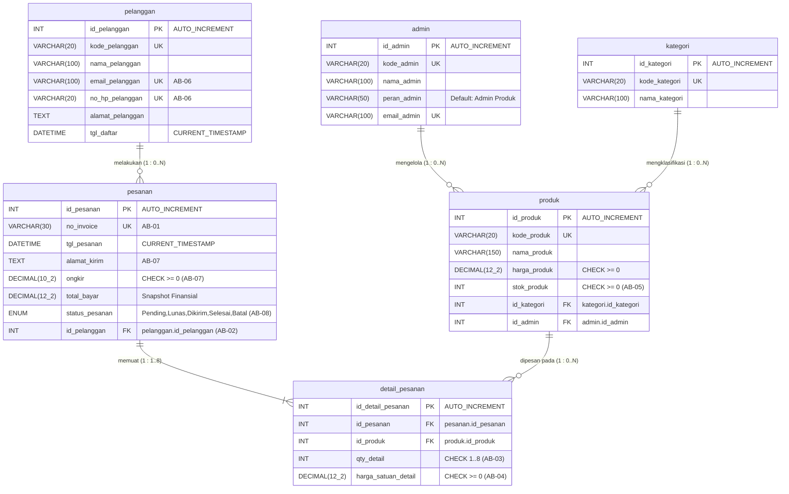
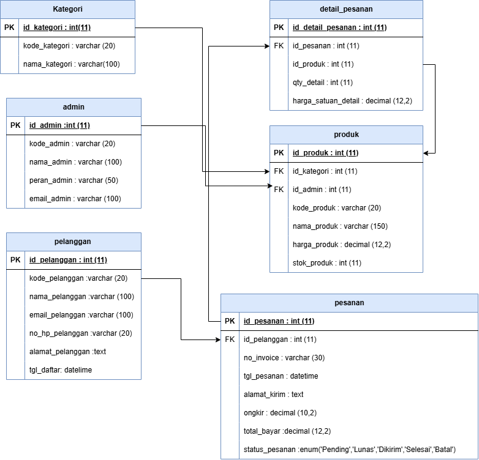
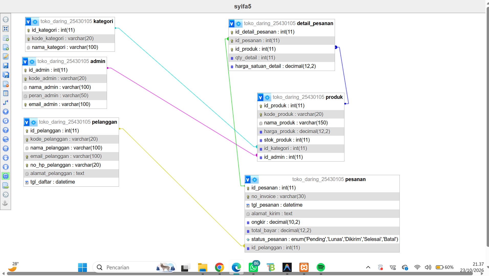

# Laporan Praktikum Basis Data - Pertemuan 05 (DDL dan ERD Fisik)
**Nama:** Syifa  
**NIM:** 25430105  
**Kelas:** Basis Data Praktikum (Semester 3)  
**Tanggal:** 23 Oktober 2026  
**Dosen/Asisten:** Dedi Irawan, S.Kom., M.T.I.  
**Proyek:** Toko Daring Cendekia SA (Sistem E-Commerce)  
**Dokumen Acuan:** `p02_kebutuhan_data_25430105.md` & `p04_normalisasi_25430105.md`  
**Berkas SQL:** [`p05_ddl_25430105.sql`](file:///d:/Praktikum/basisdata-25430105/p05_ddl_25430105.sql)  

---

## 1. Identitas dan Parameter Personal Proyek

Berdasarkan ketentuan personalisasi data praktikum menggunakan 2 digit terakhir NIM (**NIM: 25430105** $\rightarrow$ `05`):

1. **Perhitungan Parameter Personal $P$:**
   $$P = (\text{2 digit terakhir NIM} \pmod 9) + 1 = (05 \pmod 9) + 1 = 5 + 1 = \mathbf{6}$$
2. **Aturan Batas Maksimal Pembelian ($P + 2$):**
   $$\text{Batas } P + 2 = 6 + 2 = \mathbf{8\text{ item}}$$
3. **Volume Transaksi Harian:**
   $$\text{Volume Transaksi} = 40 + (5 \times P) = 40 + (5 \times 6) = \mathbf{70\text{ transaksi/hari}}$$
4. **Konvensi Standar Penamaan Kolom Kunci (Sesuai Ketentuan Tugas):**
   - **Kunci Primer (*Primary Key*):** Wajib menggunakan format **`id_<nama_tabel>`**  
     Contoh: `id_pelanggan`, `id_admin`, `id_kategori`, `id_produk`, `id_pesanan`, `id_detail_pesanan`.
   - **Kunci Tamu (*Foreign Key*):** Wajib menggunakan format **`id_<nama_tabel_tujuan>`**  
     Contoh: `id_kategori` (merujuk ke `kategori`), `id_admin` (merujuk ke `admin`), `id_pelanggan` (merujuk ke `pelanggan`), `id_pesanan` (merujuk ke `pesanan`), `id_produk` (merujuk ke `produk`).

---

## 2. Analisis Mendalam Aturan Batas $P+2$ (Modul 2) dan Daya Jangkau DDL

Sesuai aturan bisnis **AB-03** pada dokumen kebutuhan data Modul 2: *"Batas maksimal pembelian produk dalam satu transaksi pesanan adalah 8 item ($P+2 = 6+2$)."*  
Dalam perancangan fisik DDL, aturan ini dianalisis ke dalam dua tingkatan jangkauan integritas struktural:

### 2.1 Analisis Ranah Satu Baris (*Single-Row Scope / Intra-Row*)
- **Objek:** Kuantitas pembelian pada satu baris rincian item barang (`detail_pesanan.qty_detail`).
- **Penerapan Teknis:** Setiap baris item yang dipesan harus bernilai minimal 1 dan tidak boleh melampaui batas atas paket pembelian personal $P+2 = 8$.
- **Realisasi DDL:** Dapat diwujudkan secara mandiri dan efektif menggunakan **`CONSTRAINT CHECK`**:
  ```sql
  CONSTRAINT chk_detail_qty CHECK (qty_detail >= 1 AND qty_detail <= 8) -- [AB-03]
  ```
- **Karakteristik Engine:** Mesin MariaDB (versi 10.2.1+) dan MySQL (versi 8.0.16+) mengevaluasi ekspresi CHECK ini saat operasi `INSERT` maupun `UPDATE`. Jika nilai `qty_detail` bernilai di luar rentang $1 \dots 8$, operasi langsung ditolak dengan pesan kesalahan *Check constraint violated*.

### 2.2 Analisis Ranah Banyak Baris / Akumulasi Transaksi (*Multi-Row Scope / Inter-Row*)
- **Objek:**
  1. Total akumulasi kuantitas seluruh item dalam satu transaksi pesanan: $\sum \text{qty\_detail} \le 8$.
  2. Aturan **AB-01**: Setiap faktur pesanan wajib memuat minimal 1 baris item produk (kardinalitas mandatori $1 \dots N$).
- **Analisis Daya Jangkau DDL (Mengapa CHECK Constraint Tidak Mampu Menjaganya?):**
  1. **Batasan Standar ANSI SQL & RDBMS Engine:** Klausa `CONSTRAINT CHECK` pada standar SQL relasional dirancang khusus untuk memvalidasi predikat skalar pada baris yang sedang diproses (*intra-row predicate*). Mesin basis data secara eksplisit **melarang subquery, fungsi agregasi (`SUM()`, `COUNT()`), maupun pemanggilan tabel silang** di dalam definisi CHECK constraint tabel.
  2. **Anomali Urutan Penyisipan (*Insertion Order Paradox*):** Pada skema relasional, tabel kepala (`pesanan`) harus disisipkan terlebih dahulu sebelum baris anak (`detail_pesanan`) dapat dibuat. Pada mikrodetik ketika baris `pesanan` masuk, jumlah baris detailnya masih 0 (melanggar syarat minimal 1 baris). Tabel induk tidak memiliki mekanisme bawaan untuk menahan diri jika baris anak belum ada.
  3. **Penolakan Validasi Multi-Baris Statis:** MariaDB/MySQL tidak dapat menghitung apakah penambahan baris produk ke-3 menyebabkan total belanja melebihi 8 item hanya melalui deklarasi DDL tabel.
- **Tandai untuk Diselesaikan pada Modul 14:**
  - Keterbatasan DDL ini dicatat secara resmi sebagai **utang desain struktural** yang akan ditangani tuntas pada **Modul 14 (Transaksi ACID dan Integritas Prosedural)**.
  - Solusi Modul 14 akan menggunakan kontrol Transaksi Atomik (`START TRANSACTION ... COMMIT / ROLLBACK`) serta Database Trigger `BEFORE INSERT ON detail_pesanan` untuk menghitung akumulasi total kuantitas per pesanan.

---

## 3. Matriks Aturan Bisnis (AB) dan Realisasi Constraint DDL

| Kode AB | Bunyi Aturan Bisnis | Tabel Target | Kolom Terlibat | Jenis Constraint DDL | Sintaks Implementasi DDL |
| :--- | :--- | :--- | :--- | :--- | :--- |
| **AB-01** | Setiap pesanan memiliki nomor invoice unik | `pesanan` | `no_invoice` | `UNIQUE`, `NOT NULL` | `CONSTRAINT uk_pesanan_invoice UNIQUE (no_invoice)` |
| **AB-01** | Pesanan minimal memuat 1 item produk | `pesanan`, `detail_pesanan` | Relasi Induk-Anak | *Multi-row integrity* | *Tidak dapat dijaga DDL murni; Ditandai untuk Modul 14 (Transaksi ACID).* |
| **AB-02** | Pembelian hanya oleh pelanggan terdaftar | `pesanan` | `id_pelanggan` | `FOREIGN KEY` | `CONSTRAINT fk_pesanan_pelanggan FOREIGN KEY (id_pelanggan) REFERENCES pelanggan(id_pelanggan) ON UPDATE CASCADE ON DELETE RESTRICT` |
| **AB-03** | Batas pembelian per item $P+2=8$ ($P=6$) | `detail_pesanan` | `qty_detail` | `CHECK` | `CONSTRAINT chk_detail_qty CHECK (qty_detail >= 1 AND qty_detail <= 8)` |
| **AB-03** | Batas total pembelian per pesanan $\le 8$ | `detail_pesanan` | Agregasi baris | *Multi-row aggregate* | *Tidak dapat dijaga CHECK; Ditandai untuk Modul 14 (Trigger / ACID Transaction).* |
| **AB-04** | Harga produk disimpan historis per rincian | `detail_pesanan` | `harga_satuan_detail` | `DECIMAL`, `CHECK` | `CONSTRAINT chk_detail_harga CHECK (harga_satuan_detail >= 0)` |
| **AB-05** | Stok produk tidak boleh bernilai negatif | `produk` | `stok_produk` | `CHECK` | `CONSTRAINT chk_produk_stok CHECK (stok_produk >= 0)` |
| **AB-06** | Email dan No HP pelanggan unik | `pelanggan` | `email_pelanggan`, `no_hp_pelanggan` | `UNIQUE` | `CONSTRAINT uk_pelanggan_email UNIQUE (email_pelanggan)`,<br>`CONSTRAINT uk_pelanggan_no_hp UNIQUE (no_hp_pelanggan)` |
| **AB-07** | Alamat kirim dan ongkir dicatat per order | `pesanan` | `alamat_kirim`, `ongkir` | `TEXT`, `CHECK` | `alamat_kirim TEXT NOT NULL`,<br>`CONSTRAINT chk_pesanan_ongkir CHECK (ongkir >= 0)` |
| **AB-08** | Status pesanan terkontrol | `pesanan` | `status_pesanan` | `ENUM` | `status_pesanan ENUM('Pending','Lunas','Dikirim','Selesai','Batal') DEFAULT 'Pending'` |

---

## 4. Tabel Pemetaan Tipe Data (Konseptual ke Fisik MariaDB)

### 4.1 Tabel `pelanggan`
| Nama Kolom | Tipe Konseptual | Tipe Fisik (MariaDB) | Panjang / Presisi | Sifat Kolom | Aturan Bisnis | Justifikasi Pemilihan Tipe Data |
| :--- | :--- | :--- | :--- | :--- | :--- | :--- |
| `id_pelanggan` | Integer | `INT` | 11 digit (4 byte) | `PK, AUTO_INCREMENT, NOT NULL` | Standar PK | Surrogate key numerik efisien untuk indexing B-Tree dan relasi FK. |
| `kode_pelanggan` | Karakter | `VARCHAR(20)` | Maks 20 karakter | `UNIQUE, NOT NULL` | Dokumen Sumber | Alfanumerik dinamis berformat `PLG-xxxx`, hemat ruang dibanding `CHAR`. |
| `nama_pelanggan` | Teks Pendek | `VARCHAR(100)` | Maks 100 karakter | `NOT NULL` | Identitas | Mengakomodasi variasi nama lengkap pelanggan Indonesia. |
| `email_pelanggan` | Karakter | `VARCHAR(100)` | Maks 100 karakter | `UNIQUE, NOT NULL` | **AB-06** | Standar format alamat surat elektronik (RFC 5322) dan bersifat unik. |
| `no_hp_pelanggan` | Karakter | `VARCHAR(20)` | Maks 20 karakter | `UNIQUE, NOT NULL` | **AB-06** | Disimpan string untuk menjaga awalan angka '0' atau kode internasional '+62'. |
| `alamat_pelanggan` | Teks Panjang | `TEXT` | Maks 65.535 byte | `NOT NULL` | Domisili | Alamat domisili lengkap dapat memuat nama jalan, kelurahan, kecamatan, dan kode pos. |
| `tgl_daftar` | Waktu | `DATETIME` | 8 byte | `NOT NULL, DEFAULT CURRENT_TIMESTAMP` | Audit | Mencatat waktu presisi (tahun hingga detik) pelanggan mendaftarkan akun. |

### 4.2 Tabel `admin`
| Nama Kolom | Tipe Konseptual | Tipe Fisik (MariaDB) | Panjang / Presisi | Sifat Kolom | Aturan Bisnis | Justifikasi Pemilihan Tipe Data |
| :--- | :--- | :--- | :--- | :--- | :--- | :--- |
| `id_admin` | Integer | `INT` | 4 byte | `PK, AUTO_INCREMENT, NOT NULL` | Standar PK | Kunci primer identitas administrator internal. |
| `kode_admin` | Karakter | `VARCHAR(20)` | Maks 20 karakter | `UNIQUE, NOT NULL` | Identitas | Format alfanumerik `ADM-xx` untuk penandaan staf. |
| `nama_admin` | Teks Pendek | `VARCHAR(100)` | Maks 100 karakter | `NOT NULL` | Personil | Menampung nama lengkap staf admin penanggung jawab katalog. |
| `peran_admin` | Karakter | `VARCHAR(50)` | Maks 50 karakter | `NOT NULL, DEFAULT 'Admin Produk'` | Hak Akses | Mendukung kontrol otorisasi *Role-Based Access Control* (RBAC). |
| `email_admin` | Karakter | `VARCHAR(100)` | Maks 100 karakter | `UNIQUE, NOT NULL` | Akun Login | Unik untuk verifikasi akun kerja dan login sistem. |

### 4.3 Tabel `kategori`
| Nama Kolom | Tipe Konseptual | Tipe Fisik (MariaDB) | Panjang / Presisi | Sifat Kolom | Aturan Bisnis | Justifikasi Pemilihan Tipe Data |
| :--- | :--- | :--- | :--- | :--- | :--- | :--- |
| `id_kategori` | Integer | `INT` | 4 byte | `PK, AUTO_INCREMENT, NOT NULL` | Standar PK | Kunci primer klasifikasi produk. |
| `kode_kategori` | Karakter | `VARCHAR(20)` | Maks 20 karakter | `UNIQUE, NOT NULL` | Klasifikasi | Kode alfanumerik unik pengelompokan etalase barang (`KAT-01`). |
| `nama_kategori` | Teks Pendek | `VARCHAR(100)` | Maks 100 karakter | `NOT NULL` | Tampilan | Label nama kategori seperti Pakaian Pria, Elektronik, dll. |

### 4.4 Tabel `produk`
| Nama Kolom | Tipe Konseptual | Tipe Fisik (MariaDB) | Panjang / Presisi | Sifat Kolom | Aturan Bisnis | Justifikasi Pemilihan Tipe Data |
| :--- | :--- | :--- | :--- | :--- | :--- | :--- |
| `id_produk` | Integer | `INT` | 4 byte | `PK, AUTO_INCREMENT, NOT NULL` | Standar PK | Kunci primer produk katalog toko. |
| `kode_produk` | Karakter | `VARCHAR(20)` | Maks 20 karakter | `UNIQUE, NOT NULL` | Dokumen Sumber | Kode SKU alfanumerik barang (`PRD-001`) yang dicari kasir/pembeli. |
| `nama_produk` | Teks Pendek | `VARCHAR(150)` | Maks 150 karakter | `NOT NULL` | Katalog | Nama deskriptif barang dagangan beserta varian/ukurannya. |
| `harga_produk` | Uang/Moneter | `DECIMAL(12, 2)` | 12 digit (2 desimal) | `NOT NULL, CHECK (>=0)` | Katalog | Menjamin akurasi finansial tanpa risiko pembulatan biner *floating-point*. |
| `stok_produk` | Integer | `INT` | 4 byte | `NOT NULL, DEFAULT 0, CHECK (>=0)` | **AB-05** | Kuantitas unit fisik di gudang; CHECK mencegah nilai stok negatif. |
| `id_kategori` | Integer | `INT` | 4 byte | `FK, NOT NULL` | Relasi ERD | Kunci tamu berformat `id_<tabel_tujuan>` merujuk ke `kategori(id_kategori)`. |
| `id_admin` | Integer | `INT` | 4 byte | `FK, NOT NULL` | Relasi ERD | Kunci tamu berformat `id_<tabel_tujuan>` merujuk ke `admin(id_admin)`. |

### 4.5 Tabel `pesanan`
| Nama Kolom | Tipe Konseptual | Tipe Fisik (MariaDB) | Panjang / Presisi | Sifat Kolom | Aturan Bisnis | Justifikasi Pemilihan Tipe Data |
| :--- | :--- | :--- | :--- | :--- | :--- | :--- |
| `id_pesanan` | Integer | `INT` | 4 byte | `PK, AUTO_INCREMENT, NOT NULL` | Standar PK | Kunci primer transaksi pemesanan penjualan online. |
| `no_invoice` | Karakter | `VARCHAR(30)` | Maks 30 karakter | `UNIQUE, NOT NULL` | **AB-01** | Nomor faktur legal resmi `INV-YYYYMM-xxxx` yang bersifat unik. |
| `tgl_pesanan` | Waktu | `DATETIME` | 8 byte | `NOT NULL, DEFAULT CURRENT_TIMESTAMP` | Transaksi | Mencatat waktu pesanan dilakukan pembeli (audit trail transaksi). |
| `alamat_kirim` | Teks Panjang | `TEXT` | Maks 65.535 byte | `NOT NULL` | **AB-07** | Alamat tujuan kirim khusus transaksi ini (bisa berbeda dari domisili). |
| `ongkir` | Uang/Moneter | `DECIMAL(10, 2)` | 10 digit (2 desimal) | `NOT NULL, DEFAULT 0, CHECK (>=0)` | **AB-07** | Biaya tarif ekspedisi pengiriman paket barang. |
| `total_bayar` | Uang/Moneter | `DECIMAL(12, 2)` | 12 digit (2 desimal) | `NOT NULL, DEFAULT 0, CHECK (>=0)` | Snapshot Finansial | *Frozen snapshot* tagihan legal transaksi untuk gateway pembayaran. |
| `status_pesanan` | Pilihan Nilai | `ENUM(...)` | 1 byte | `NOT NULL, DEFAULT 'Pending'` | **AB-08** | Nilai terbatas ('Pending','Lunas','Dikirim','Selesai','Batal') hemat ruang. |
| `id_pelanggan` | Integer | `INT` | 4 byte | `FK, NOT NULL` | **AB-02** | Kunci tamu berformat `id_<tabel_tujuan>` merujuk ke `pelanggan(id_pelanggan)`. |

### 4.6 Tabel `detail_pesanan`
| Nama Kolom | Tipe Konseptual | Tipe Fisik (MariaDB) | Panjang / Presisi | Sifat Kolom | Aturan Bisnis | Justifikasi Pemilihan Tipe Data |
| :--- | :--- | :--- | :--- | :--- | :--- | :--- |
| `id_detail_pesanan`| Integer | `INT` | 4 byte | `PK, AUTO_INCREMENT, NOT NULL` | Standar PK | Kunci primer tabel rincian (memenuhi format `id_<nama_tabel>`). |
| `id_pesanan` | Integer | `INT` | 4 byte | `FK, NOT NULL` | Relasi ERD | Kunci tamu berformat `id_<tabel_tujuan>` merujuk ke `pesanan(id_pesanan)`. |
| `id_produk` | Integer | `INT` | 4 byte | `FK, NOT NULL` | Relasi ERD | Kunci tamu berformat `id_<tabel_tujuan>` merujuk ke `produk(id_produk)`. |
| `qty_detail` | Integer | `INT` | 4 byte | `NOT NULL, CHECK (1..8)` | **AB-03** | Jumlah unit barang dibeli; CHECK menegakkan batas minimal 1 dan maksimal 8 ($P+2$). |
| `harga_satuan_detail`| Uang/Moneter | `DECIMAL(12, 2)`| 12 digit (2 desimal) | `NOT NULL, CHECK (>=0)` | **AB-04** | Harga jual saat transaksi terjadi (historis), tidak terpengaruh kenaikan katalog. |

---

## 5. Diagram ERD Fisik Proyek



### Tempat Gambar Tangkapan Layar ERD Fisik:
> [!NOTE]
> Berkas sumber diagram draw.io: [`modul5/p05_erd_fisik_25430105.drawio`](file:///d:/Praktikum/basisdata-25430105/modul5/p05_erd_fisik_25430105.drawio).  
> Gambar ditempatkan pada path: `modul5/img/p05_erd_fisik_25430105.png`.

  
*Gambar 5.1: Diagram Relasi Entitas Fisik (Physical ERD) Toko Daring Cendekia SA.*

---

## 6. Hasil Perbandingan Designer Basis Data dengan ERD

### Tempat Gambar Tangkapan Layar Designer:
> [!NOTE]
> Gambar tangkapan layar Designer phpMyAdmin ditempatkan pada path: `modul5/img/p05_designer_25430105.png`.

  
*Gambar 6.1: Tampilan skema relasional tabel Toko Daring Cendekia SA pada antarmuka Designer phpMyAdmin.*

### Tabel Evaluasi Komparasi:
| Aspek Rancangan | Desain ERD Fisik | Realisasi pada phpMyAdmin Designer | Status Kesesuaian | Analisis Teknis |
| :--- | :--- | :--- | :--- | :--- |
| **Jumlah Tabel** | 6 Tabel (`pelanggan`, `admin`, `kategori`, `produk`, `pesanan`, `detail_pesanan`) | 6 Tabel terdaftar di database `toko_daring_25430105` | **Sesuai (100%)** | Seluruh tabel master dan transaksi tercipta lengkap dengan storage engine InnoDB. |
| **Kunci Primer (PK)** | Format seragam: `id_<nama_tabel>` pada seluruh 6 tabel | Muncul ikon kunci emas (*Primary Key Index*) pada kolom `id_<nama_tabel>` | **Sesuai (100%)** | Seluruh tabel berhasil menerapkan surrogate key numerik bertipe `INT AUTO_INCREMENT`. |
| **Kunci Tamu (FK)** | Format seragam: `id_<tabel_tujuan>` | Garis relasi fisik (*connector line*) menghubungkan kolom FK ke kolom PK tabel induk | **Sesuai (100%)** | Relasi antar tabel terhubung dengan benar dan aksi referensial CASCADE/RESTRICT aktif. |
| **Kunci Unik (UK)** | `kode_pelanggan`, `email`, `no_hp`, `no_invoice`, dll. | Terbentuk index unik berjenis `UNIQUE` (*silver key icon*) | **Sesuai (100%)** | Menjaga keunikan data identitas dan faktur. |
| **Batasan CHECK** | `stok_produk >= 0`, `qty_detail BETWEEN 1 AND 8`, dll. | Tersimpan pada metadata tabel (`TABLE_CONSTRAINTS`) | **Sesuai (100%)** | Engine MariaDB 10.2+/MySQL 8.0+ menegakkan validasi CHECK saat operasi DML dijalankan. |

---

## 7. Pembahasan dan Kendala

### 7.1 Pembahasan
1. **Keunggulan Konvensi Penamaan `id_<nama_tabel>` dan `id_<nama_tabel_tujuan>`:**  
   Konsistensi penamaan ini membuat struktur basis data sangat rapi dan mudah dibaca oleh siapapun. Primary Key selalu diawali dengan nama tabel pemiliknya, dan Foreign Key selalu mencerminkan nama tabel tujuannya secara langsung tanpa kebingungan alias.
2. **Kesesuaian Tipe Data Keuangan:**  
   Kolom moneter (`harga_produk`, `ongkir`, `total_bayar`, `harga_satuan_detail`) secara konsisten menggunakan tipe data `DECIMAL` untuk mencegah galat presisi nilai mata uang.

### 7.2 Kendala dan Pemecahan
- **Kendala 1 (Keterbatasan CHECK pada Validasi Akumulasi Multi-Baris):**  
  Aturan bahwa jumlah total barang dalam satu transaksi tidak boleh > 8 item tidak dapat diterapkan langsung melalui constraint CHECK tabel DDL karena MariaDB menolak subquery di dalam klausa CHECK.  
  *Pemecahan:* Kuantitas per item disaring di Modul 5 dengan `CHECK (qty_detail BETWEEN 1 AND 8)`, dan akumulasi transaksi ditandai untuk diselesaikan di Modul 14 menggunakan kontrol Transaksi ACID dan Trigger.
- **Kendala 2 (Idempotensi Eksekusi Skrip DDL):**  
  Menjalankan ulang skrip DDL sering memicu galat dependensi foreign key saat menghapus tabel.  
  *Pemecahan:* Menggunakan sintaks pembungkus `SET FOREIGN_KEY_CHECKS = 0;` sebelum penataan ulang tabel dan mengembalikannya ke `1` setelah selesai.

---

## 8. Kesimpulan
Implementasi Data Definition Language (DDL) pada berkas `p05_ddl_25430105.sql` berhasil merealisasikan seluruh struktur skema Toko Daring Cendekia SA secara utuh dan idempoten. Seluruh tabel telah menerapkan konvensi Kunci Primer `id_<nama_tabel>` dan Kunci Tamu `id_<nama_tabel_tujuan>`, serta constraint aturan bisnis (AB-01 s.d AB-08) dan aturan batas $P+2 = 8$ telah diintegrasikan dengan tepat sesuai ranah strukturalnya.

---

## 9. Pernyataan Penggunaan AI
Dalam pengerjaan laporan praktikum Modul 5 ini, praktikan memanfaatkan asisten AI (Antigravity / Gemini) untuk membantu validasi sintaks DDL MariaDB, memformulasikan analisis batasan ANSI SQL CHECK single-row vs multi-row, serta mengonstruksi diagram Mermaid ERD fisik. Seluruh isi analisis dan skema tabel dirumuskan secara mandiri sesuai dokumen kebutuhan data praktikum.

---

## 10. Bukti Git
- **Tautan Repositori GitHub:** [https://github.com/syifa040706/basisdata-25430105](https://github.com/syifa040706/basisdata-25430105)
- **Format Pesan Commit:** `p05: implementasi ddl dan pemetaan erd fisik proyek toko daring`
- **Hash Commit:** *(Menyusul setelah commit dilakukan)*

---

## Checklist Evaluasi
- [x] Berkas `p05_ddl_25430105.sql` dapat dijalankan ulang dari kondisi basis data kosong (idempoten).
- [x] Seluruh tabel memiliki Kunci Primer dengan format penamaan **`id_<nama_tabel>`**.
- [x] Seluruh relasi memiliki Kunci Tamu dengan format penamaan **`id_<nama_tabel_tujuan>`**.
- [x] Setiap aturan bisnis yang dapat dijaga struktur menjadi constraint berlabel komentar **`AB-xx`**.
- [x] Aturan batas $P+2=8$ (NIM 05 $\rightarrow P=6$) dianalisis tuntas:
  - [x] Satu baris diwujudkan dengan `CHECK (qty_detail BETWEEN 1 AND 8)`.
  - [x] Banyak baris dicatat keterbatasannya pada CHECK dan ditandai diselesaikan di Modul 14.
- [x] Tempat gambar tangkapan layar ERD fisik (`p05_erd_fisik_25430105.png`) dan berkas sumber diagram (`p05_erd_fisik_25430105.drawio`) disiapkan lengkap.
- [x] Tabel pemetaan tipe data konseptual ke fisik MariaDB didokumentasikan lengkap untuk 6 tabel beserta justifikasinya.
- [x] Hasil perbandingan fitur Designer phpMyAdmin dengan rancangan ERD dievaluasi secara mendalam.
- [x] Tempat gambar tangkapan layar Designer (`p05_designer_25430105.png`) disiapkan.
- [x] Laporan praktikum memenuhi identitas mahasiswa, pembahasan, kendala, kesimpulan, dan checklist.
